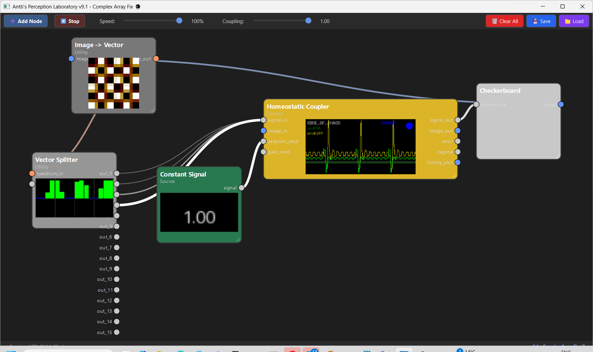

# GeometricNeuronOriginReview



**ECG JSON / ECG-like pulse finally explained**

> **Update, 8 November 2026: [causal reduction](docs/CAUSAL_REDUCTION.md).** The whole image branch can be replaced by one lookup table r = F_D(q) with a bit-exact identical trajectory. The faithful reload has an exact period of **59** ticks, because the host's loop takes four ticks. The September "52" is exactly what a one-tick loop gives. The integral state is never read in this mode. Clamping the feedback stops the rhythm, and permuting the controller's window (same mean and variance) changes the future every time. Two statements below are corrected in place.

> **Update, 10 November 2026: [the forgetting clock](docs/FORGETTING_CLOCK.md).** The loop beats when it forgets its last beat. Period = 50 (memory) + 1 (noticing) + 4 (kick reaches the blind zone) + 4 (zero comes back as a spike) = **59**, and the law W + 2d + c (c from −1 to +4) holds in 186 of 204 settings. The 50-sample window acts as a refractory period. Every beat passes through the blind zone: the zero reading is what fires the spike. From 3000 random starts there is **one** attractor. Small kicks are erased completely; a strong negative kick resets the clock like a premature heartbeat. And the beat needs **abrupt** forgetting: soften the window's edge beyond about twice the loop delay and the same controller regulates quietly with no pulse. So the loop is an excitable unit (threshold, refractory period, reset). It is not a neuron and not a synapse.

This repository freezes the small Perception Lab graph that helped start the later Geometric Neuron / Operaattori / SighImageSuper line of work.

The original graph is [`ecg.json`](ecg.json). The node implementations used by that graph are copied here so the mechanism can be audited without relying on memory or on a later Perception Lab version.

The source laboratory is:

- [anttiluode/PerceptionLab — "Lego set science"](https://github.com/anttiluode/PerceptionLab)

Later descendants of the same question include:

- [SighImageSuper](https://github.com/anttiluode/SighImageSuper)
- [OperaattoriAktiivinenDendriitti](https://github.com/anttiluode/OperaattoriAktiivinenDendriitti)
- [Operaattori](https://github.com/anttiluode/Operaattori)

---

## The graph

The saved loop is:

```text
Constant Signal = 1
        |
        v
Homeostatic Coupler
        |
        v
Checkerboard generator
        |
        v
Image -> Vector
        |
        v
Vector Splitter
   | | | |
   +-----+------> first four values back to Homeostatic Coupler
```

The coupler output controls checkerboard square size. The checkerboard is converted to a vector, the vector is split, and the first four returned values become the next feedback input.

The important correction is that those four values are **not four eigenmodes**.

`ImageToVectorNode` converts RGB to gray, resizes the image to a square with

```text
side = ceil(sqrt(output_dim))
```

using area interpolation, flattens that resized image row-by-row, trims/pads to the requested dimension, and normalizes by the largest absolute value.

`VectorSplitterNode` then keeps the first `num_outputs` values. In `ecg.json`, only `out_0`, `out_1`, `out_2`, and `out_3` are wired back to the coupler.

So the feedback signal is better described as **four spatial samples from a resolution-dependent coarse image representation**.

---

## Why vector size changed the pulse

Changing `output_dim` changes the resize grid before flattening:

```text
256   -> 16 x 16
1024  -> 32 x 32
2048  -> 46 x 46  (ceil(sqrt(2048)))
```

The same four wires therefore refer to different spatial support at different vector sizes.

That changes the measurement operator inside the feedback loop.

This is the key correction to the old story:

> **Changing vector size did not select different Fourier/eigen modes. It changed what part of the generated spatial state the feedback controller measured.**

Because the measurement is inside the loop, changing the measurement changes the future trajectory of the system.

---

## Why the ECG-like rhythm appears

The Homeostatic Coupler was running in `edge_of_chaos` mode. It estimates variance over a finite recent-history window and alternates between two responses:

```text
variance too low   -> amplify deviation
variance too high  -> damp deviation
```

The saved graph uses:

```text
target_variance = 0.1
variance_window = 50
```

~~The controller also keeps a slower integral/setpoint state.~~ *Corrected:* in `edge_of_chaos` mode the controller updates `integral_state` but never reads it, so setting it to ±1e9 leaves the trajectory identical ([causal reduction](docs/CAUSAL_REDUCTION.md)).

The resulting loop is therefore not a simple oscillator. It is a nonlinear delayed feedback system:

```text
spatial generator
      ->
resolution-dependent measurement
      ->
finite-memory variance controller
      ->
new generator scale
      ->
new spatial measurement
      -> ...
```

In the reconstruction used during the September 2026 review, the 256-dimensional setup produced a long rhythm of roughly 52 ticks under the stated one-tick update schedule. Changing only `variance_window` from 50 to 30 changed that long rhythm to roughly 32 ticks. *(8 Nov: a one-tick loop gives exactly 52 and 32. Perception Lab's real scheduler makes the loop four ticks long, which gives exactly 59 and 38.)* The 1024-dimensional setup instead fell into a short alternating regime. The exact waveform depends on scheduler details and node implementation, so these numbers should be treated as a reconstruction receipt rather than a biological claim.

The strong clue is the `window + small scheduler offset` relation: the long pulse occurs when old high-variance samples leave the controller's finite window, allowing a switch from damping back to excitation.

---

## A small implementation oddity

The checkerboard node computes

```python
square_size = int(5 + size_in * 50)
```

but does not clip `size_in` to `[0,1]` even though the comment describes it as a 0-1 control.

That can alter the exact pulse shape when the coupler leaves the nominal range. It is worth preserving as part of the historical mechanism, but it is not the main conceptual result. *(8 Nov: the faithful cycle does visit negative square sizes, −11 and −9. Clipping to [0, 1] keeps a rhythm but changes it: period 62 instead of 59.)*

---

# Why this mattered later

The old ECG loop accidentally contained a version of the question that now sits at the center of the newer repos:

> **What a bounded system can recover depends not only on the hidden state, but on how it interrogates that state — and if the interrogation is fed back, the question can change the trajectory being observed.**

A useful linear shorthand is

```text
x_(t+1) = A x_t + B u_t
y_t     = C x_t
```

If the observation is fed back through a controller,

```text
u_t = p_t + K y_t
```

then the effective closed-loop evolution becomes

```text
x_(t+1) = (A + B K C) x_t + B p_t.
```

So changing the observation/controller pair changes the effective dynamics.

That is the bridge to the later work:

| project | what changes the question? |
|---|---|
| **SighImageSuper** | the evolution/filter operator changes which distinctions persist |
| **ECG / Perception Lab** | the observation is inside feedback, so changing what is sampled changes the future trajectory |
| **OperaattoriAktiivinenDendriitti** | stimulation changes which hidden dendritic distinction becomes visible at the soma |
| **Jello / developmental thread** | activity can change the material/operator through which future signals move |

The shared operational question is now:

> **Which distinctions can a bounded system make observable by choosing its inputs, observations, and temporary dynamics — while paying for uncertainty, reference memory, and the back-action of asking?**

That is much stronger, and much more defensible, than saying that the old ECG loop had somehow discovered a neuron or that its four feedback values were eigenmodes.

---

## Files

- [`ecg.json`](ecg.json) — saved Perception Lab graph
- [`checkerboardnode.py`](checkerboardnode.py) — spatial generator
- [`imagetovectornode.py`](imagetovectornode.py) — resize/flatten/normalize bridge
- [`vectorsplitternode.py`](vectorsplitternode.py) — first-value breakout
- [`coupler.py`](coupler.py) — finite-memory homeostatic/edge-of-chaos controller
- [`constantsignalnode.py`](constantsignalnode.py) — setpoint input
- [`docs/CAUSAL_REDUCTION.md`](docs/CAUSAL_REDUCTION.md) — which parts of the loop the rhythm needs (8 Nov 2026)
- [`docs/FORGETTING_CLOCK.md`](docs/FORGETTING_CLOCK.md) — what the rhythm is: a clock that beats when it forgets its last beat (10 Nov 2026)
- [`experiments/`](experiments) — headless host harness, the reduction experiment and the forgetting-clock experiment; [`tests/`](tests) — 13 regression tests; [`results/`](results) — numbers and figure

For the full node-based environment, see [PerceptionLab](https://github.com/anttiluode/PerceptionLab).
