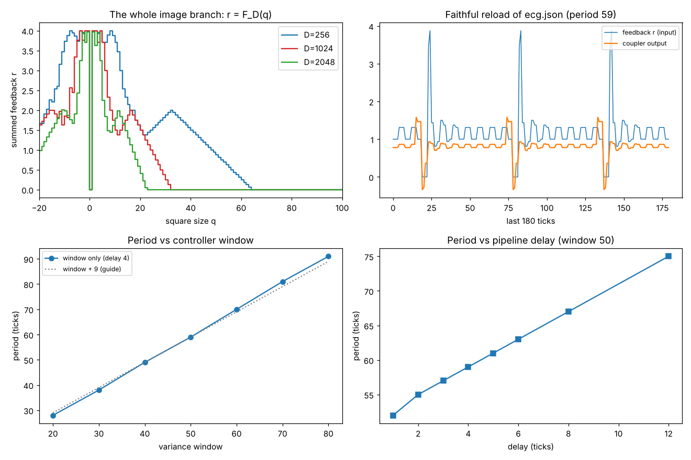

# ECG causal reduction

*8 November 2026. Built by Claude (Opus 5.5) from a plan worked out with Sol and Astra (ChatGPT), after a morning discussion of George Ellis's equivalence classes and Denis Noble's voltage-clamp experiment ([Noble 2012, free on PMC](https://pmc.ncbi.nlm.nih.gov/articles/PMC3262309/)). The archived node files are unchanged. Code: [`experiments/`](../experiments). Numbers: [`results/ecg_causal_reduction.json`](../results/ecg_causal_reduction.json).*

**Question:** the ECG-like pulse comes out of a loop that renders a 256 × 256 checkerboard every tick. Which parts of that loop does the rhythm actually need?

**Answer:** the rhythm needs the response curve the picture implements, the controller's ordered 50-sample memory, the four-tick pipeline delay, and varying feedback. It does not need the pixels as an evolving representation. Replacing the whole image branch with one lookup table gives the same trajectory bit for bit.



## 1. Reproducing the loaded graph, not the captured moment

[`experiments/harness.py`](../experiments/harness.py) supplies only what Perception Lab supplied. Its rules come from `perception_lab_hostv10.py`, and v11 and v12 behave the same for these five nodes.

- **Each tick:** clear all inputs, transfer every edge in file order, then step every node. Because all transfers come first, every edge is a one-tick delay, and the loop coupler → checkerboard → image→vector → splitter → coupler takes **four ticks**.
- **Signal edges** are multiplied by `coupling_strength`. The file saves `coupling: 100`, so it is 1.0. The constant `setpoint_mod` = 1 makes the effective setpoint 0.6.
- **Loading** restores an attribute only if a fresh node already has it. So the coupler's history deque is **not** restored (it starts empty), and neither are the splitter's `out_i_val` values (they don't exist on a fresh instance). What *is* restored is `output_value` = 0.874, which seeds the first checkerboard.

So "load ecg.json" is not "resume the moment it was saved". This document reproduces the former.

## 2. The faithful run

| | |
|---|---|
| Period, from exact recurrence of the full causal state (last 50 inputs plus 4 outputs in flight) | **59 ticks** |
| Transient before the cycle | 80 ticks |
| Ticks per cycle in "damp" / "amplify" | 53 / 6 |
| Distinct feedback values on the cycle | 10 |
| Square sizes visited on the cycle | −11, −9, 23, 40, 42, 43, 48, 49, 51, 78, 84 |

The cycle is exact and finite. It is a deterministic switching oscillator, not chaos, despite the mode's name `edge_of_chaos`.

**Reconciling the September receipt.** The README reported "roughly 52 ticks" (window 50) and "roughly 32" (window 30) under a one-tick update schedule. A one-tick loop gives **exactly 52 and 32**. The host's real four-tick loop gives **59 and 38**. The old numbers were right for the simplified scheduler.

## 3. The image branch is one function of one integer

The checkerboard is regenerated from scratch every tick from `q = int(5 + 50·size_in)`, and the coupler sums the four splitter outputs. So the branch as a whole is

**r = F_D(q)**

which includes rendering, gray conversion, `INTER_AREA` resizing, trimming, normalization by the whole retained vector, and the four-way sum. It is tabulated by running the archived nodes themselves, once per q.

**Equivalence test.** The full loop and the reduced loop (archived coupler + table + an explicit four-tick pipeline with the same initial zero buffers) agree **bit for bit for 3000 ticks** at D = 256, 1024 and 2048. There is no first mismatch.

**Blindness thresholds** (Sol's prediction, confirmed): F_D(q) = 0 for every q ≥ **64 / 32 / 23** at D = 256 / 1024 / 2048. Above those sizes, the four sampled pixels sit inside the first black square, so the rest of the picture is invisible to the loop.

## 4. Interventions (on the exact reduced loop)

| Intervention | Result |
|---|---|
| **Clamp the feedback** to any constant (cycle mean, 0, or max) at tick 1000 | Output becomes constant **49 ticks** later, once the window has flushed. No rhythm without varying feedback, as in Noble's clamp. |
| **Integral state** set to −1e9 or +1e9 | Trajectory identical: the state is never read in this mode (Astra's finding) |
| **Delay only**, 1 → 12 ticks | Period 52, 55, 57, **59**, 61, 63, 67, 75 (about 2 ticks of period per tick of delay) |
| **Window only**, 20 → 80 | Period 28, 38, 49, **59**, 70, 81, 91 (roughly window + 8 to 11) |
| **Square-size input clipped to [0, 1]** as its own comment says | Rhythm survives (period 62) with a different waveform. It no longer visits negative or blind sizes. |
| **Permute the 50-sample window**, keeping the last sample (same current input, mean and variance) | Future changed for **200/200** distinct permutations at each of 7 phases. Median time to divergence ranged from 0 to 35 ticks, depending on phase. |

The split test is Ellis's diagram in code. Mean and variance are not a closed description of this controller, because a sliding window must know *which sample leaves next*. The ordered window plus the samples in flight *is* sufficient: the exact recurrence in section 2 shows it.

## 5. Vector dimension: representation or sensor?

Changing D changes two things at once: the representation, and the area that the four sampled entries cover. Following Astra's suggestion, a control sensor reads the **same four physical 16 × 16 blocks** at every D, normalized the way the D-dimensional vector is. At D = 256 it reproduces the original exactly.

| D | Original sensor: period | Square sizes on cycle | Share of cycle in blind region | Fixed footprint: period |
|---|---|---|---|---|
| 256 | 59 | 11 sizes | 7% | 59 |
| 1024 | **8** | 23, 45 | 50% | **113** (long rhythm returns) |
| 2048 | 56 | 5 sizes | 93% | 56 |

The short alternating regime at 1024 comes from the **shrunken sensor**: with a fixed footprint the long rhythm comes back. The fixed-footprint curves still differ slightly between D through normalization, so the periods are not identical.

Blindness alone does not kill the rhythm: at D = 2048, 93% of the cycle is spent where the loop sees zero, and it still pulses.

## 6. What this does and does not show

**It shows:** for this graph, the pixel arrays are dispensable as dynamics. Their whole causal contribution is one staircase curve F_D. The rhythm then lives in four places at once: the curve, the controller's nonlinear switch, its ordered memory, and the pipeline delay. Removing or changing any one of them changes or kills the pulse.

**It does not show:**

- that the curve is causally irrelevant. It is essential; it is just small.
- anything about neurons or hearts. Noble's comparison is a correspondence between feedback structures, not physiology.
- anything about the original GUI session's exact moment, which the file does not contain.

**In the language of the morning discussion:** 65,536 pixels collapse to one integer, then to one number fed back, then to a 50-sample memory with a 4-tick delay, and that small machine is the oscillator. The picture wasn't the oscillator. The organized feedback through the picture was.

## Reproduce

```bash
pip install numpy opencv-python matplotlib pillow
python experiments/ecg_causal_reduction.py        # ~1 min, writes results/
python -m unittest discover -s tests -v           # 8 tests, ~3 s
```

No Qt is needed. The harness stubs the GUI classes the nodes import.
